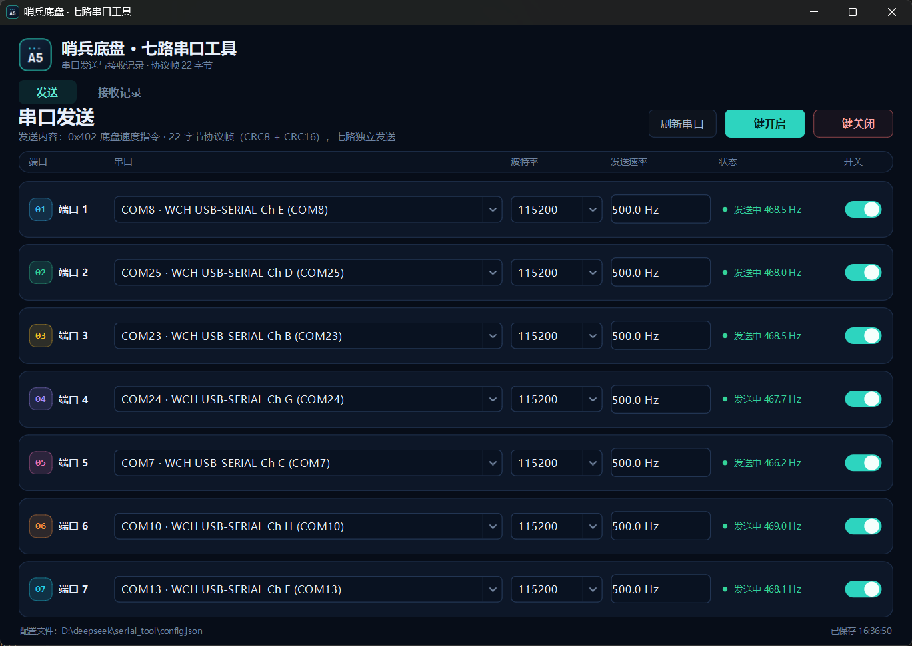
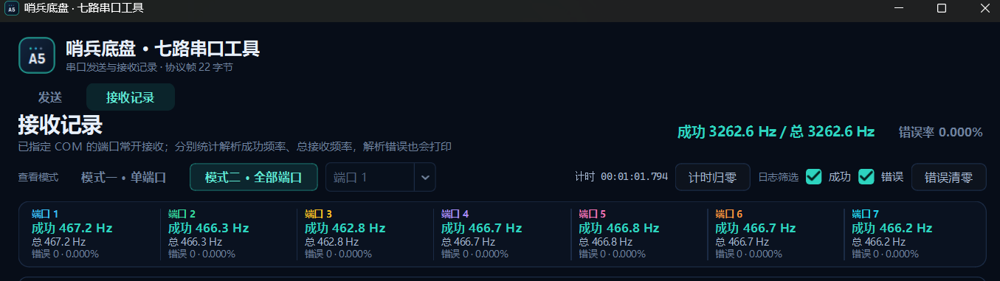

# 问题排查日志

## 串口接收逻辑错误
  - 老版本代码在接收裁判数据的时候采用dma整理数据流至HD，由于DMA双缓冲的存在HD数据流会被截断，再根据空闲中断判断数据流截止并整理HD中被切断的数据至RD，解析函数一次性读取整个RD的数据在中断中直接解析完成。以上操作导致中断中使用大量memcpy和耗时操作影响中断实时性，
  - 串口数据流整理部分存在逻辑错误且在长度切断计算中遇见计算错误的时候直接丢弃整个数据包，在多串口并发的条件下容易造成较高的接收丢包率。由于多串口同时并发且接收到的数据流密集几乎不会触发空闲中断（与实验室初期测试环境不同）导致dma切换多次缓冲区以后都未等来一个空闲中断，使得整理RD数据流的时候长度计算溢出32位整数，依据错误保护选择直接丢弃数据包导致赛场上数据无法正常收发(猜测)，最终双串口测试压测丢包率0.1%，多串口高速并发丢包率达到70%。
  - 在DMA满中断中不再重复读取NDTR寄存器，因为dma中断操作逻辑是切换完缓冲区后打开dma，然后再进入中断函数。所以在中断函数中读到的NDTR很可能是第二个缓冲区的数字。（而且似乎再读NDTR无意义，满中断NDTR理论值就是buffer长度），该问题会导致约10%的数据包因为切换缓冲区不规范操作导致数据长度计算异常并丢包。
  - 新版本代码使用环形缓冲区和状态机解析单个字符。串口空闲终端和DMA满中断中仅将字符流一个一个推入环形缓冲区，环形缓冲区解析则放在另一个线程中完成。解决了整理数据流带来的各种逻辑问题和实时性问题。
  
  
## 线程安全问题
  - 老版本代码的up_decode的函数大量运用全局变量，这个在中断一次性处理所有解析数据的时候是应该不会出现问题的（主要是因为UART所有的主优先级一致，故多个串口产生终端的时候仅按照子优先级排队处理而不会被打断），但是线程里处理的时候会出现全局变量被多个线程同时更改，故直接将全局变量挪入函数中作为局部变量存在RAM里。
  - 需要注意一下DMA和UART优先级问题，尽量让DMA满中断主优先级大于空闲中断优先级，避免空闲中断和满中断抢断顺序不确定导致数据重复推入缓冲区(万一两个同时触发呢)。
  - 少用全局变量，真正需要全局变量的时候多采用ISR进临界区。或者选择每个外设保存一个属于自己的cb控制块。
  
## 串口初始化顺序问题
  作为参考老版本代码初始化顺序是
  1. uart开启dma
  2. uart开启空闲中断
  3. DMA注册回调函数
  4. 开启双缓冲区中断接收
  5. 关闭dma半满接收中断

  - 这样的设计会导致dma还未启动的时候就将空闲接收开启了，RX收到数据后告诉dma总线拿数据，数据一直不拿走会触发数据溢出错误，数据溢出错误则会导致dma初始化失败，最终呈现的结果是如果通信板开机的时候已经有数据在输入了，通信板会有概率直接死机。解决方案则是修改初始化顺序
  1. DMA注册回调函数
  2. 清除数据溢出，空闲中断flag
  3. 开启双缓冲区中断接收
  4. 关闭dma半满接收中断
  5. uart开启dma
  6. uart开启空闲中断

  - 这样也同时解决了因为空闲中断flag未清除的时候打开空闲中断，使得开机上电无论收没收到数据都会进入中断处理函数的问题。但由于length计算等于0所以没有影响之后的处理，但仍需要解决。
  
# 优化内容

## 发送回调
  - 新版DMA发送完成的回调函数会先检查邮箱是否有数据需要发送，如果是的话直接启动下一轮DMA传输，如果不是的话则释放信号量等待新的TX_send函数。
  - TX_send函数则在推入邮箱成功后直接检查信号量是否为串口空闲，如果是的话直接发送。这样的设计可以直接取消原来的TX发送线程，可以大大减少8个串口发送函数占用的堆栈。
  - 串口发送之所以不用循环缓冲区是因为UART_DMA_Transmit函数仅将数据地址写入dma寄存器而不会维护数据的完整性。在dma传输成功前都需要保证发送数据内存池不被修改，故直接使用邮箱是最好的解决方案因为cmsis提供的邮箱接口在拿到邮箱后不会自动释放邮箱内存而是等待代码Free邮箱空间。还有一个思路是环形缓冲区维护两套头尾指针分别针对读写操作。（挖坑）
  
# 总结
 -  联调越早越好，哨兵组不像步兵和英雄可以一个电控干几乎所有的活，需要各位伙伴齐心协力一起推进进度而不是一直被互相卡着。以上问题本应该尽早发现尽早解决，而不是到了沈阳后才定位到通信板发送问题后只能临时采用各种补丁。
  - 回忆初期拍摄的时候早已发现哨兵有的时候会跑偏而且停不下来，当时以为是导航和避障问题而忽略了，回头想想可能通信板当时没接入裁判系统的时候已经轻微不稳定了，到沈阳后接入裁判后不稳定性急剧上升，但是装车装的太晚了已经来不及检修了。以上问题有充足的时间和提前准备好的压测软件和环境后其实不难排查。
  - 虽然通信板大概率是不会再用了，但是接收数据流的代码应该还是可以参考一下。
  
  
    